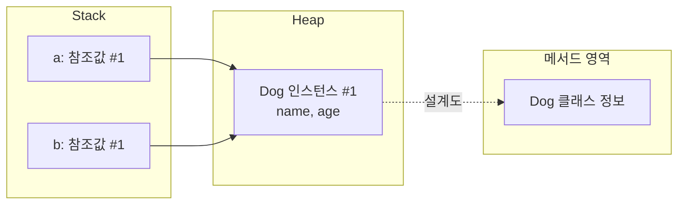

# 클래스, 인스턴스, 참조변수

## 개념 정의

> 클래스는 인스턴스의 **설계도이자 타입**이고, 인스턴스는 `new` 로 클래스를 바탕으로 **힙에 생성된 실체**이며, 참조변수는 그 인스턴스의 **참조값을 담아 가리키는** 변수다.

| 비유 | 자바 | 위치 | 개수 |
|---|---|---|---|
| TV 설계도 | 클래스 (`Dog`) | 메서드 영역 | 1개 |
| TV | 인스턴스 (`new Dog()` 의 결과) | 힙 | `new` 실행 횟수만큼 |
| 리모컨 | 참조변수 (`a`, `b`) | 스택(지역변수일 때) | 선언한 만큼 |

### 클래스의 두 역할

1. **타입** — 변수에 무엇을 담을 수 있는지 정한다. `int x` 의 `int` 가 x 의 위치가 아니라 담을 값의 종류를 정하듯, `Dog a` 의 `Dog` 도 a 에 담길 것의 종류를 정한다.

   ```java
   Dog a = new Cat();   // 컴파일 에러 — Cat 이 Dog 의 하위 타입이 아니면 타입 불일치
   ```

2. **설계도** — `new` 할 때 어떤 필드·메서드를 가진 인스턴스를 만들지 정한다. 클래스 정보 자체는 힙이 아니라 메서드 영역에 하나만 있다 ([[class-loading-lifecycle]]).

### 객체 vs 인스턴스 (용어)

실무에선 섞어 쓴다. "인스턴스" 는 **어떤 클래스의** 실체인지 관계를 강조할 때 자연스럽다 — "a 는 `Dog` 의 인스턴스다".

## 작동 원리 — `new` 와 참조 복사

```java
Dog a = new Dog();
Dog b = new Dog();      // new 2번 → 힙에 인스턴스 2개

a.name = "초코";
System.out.println(b.name);  // null — b 는 다른 인스턴스
System.out.println(a == b);  // false — 참조값이 다름
```

```java
Dog a = new Dog();
Dog b = a;              // new 1번 → 인스턴스 1개, 참조값만 복사
// a.name 을 바꾸면 b.name 으로도 보이고, a == b 는 true
```



- `new` 는 ① 힙에 인스턴스 생성 → ② 참조값 반환. 변수에 들어가는 건 **②의 참조값**이다.
- `b = a` 는 **값 복사**다. 다만 복사되는 값이 참조값이라 같은 인스턴스를 가리키게 된다 — 메서드 인자 전달도 같은 원리 ([[java-pass-by-value]]).
- `==` 는 변수에 담긴 값(참조값)을 비교하므로 "같은 인스턴스인가" 가 된다 ([[reference-vs-value-equality]]).

## 트레이드오프 / 한계

- "같은 클래스" 와 "같은 인스턴스" 는 다른 질문이다. 같은 클래스의 인스턴스는 필드 **구조**는 같지만 필드 **값**은 각자 가진다(인스턴스 변수는 객체마다 한 칸, [[variable-kinds-initialization]]).
- 참조를 복사해 여러 변수가 한 인스턴스를 공유하면, 한쪽의 변경이 다른 쪽에 그대로 보인다 → 의도치 않은 공유 상태의 출발점 ([[shallow-immutability-defensive-copy]]).

> [!WARNING]
> **오답 코너**
> - **"인스턴스는 class 안에 new 로 생성된다"** — `new Dog()` 를 `Main` 안에서 실행해도 만들어지는 건 `Dog` 의 인스턴스. 클래스 **안에** 생기는 게 아니라 클래스를 **바탕으로** 힙에 생긴다.
> - **"new 를 각각 한 a, b 는 같은 곳을 참조한다"** — `new` 마다 새 인스턴스 → 다른 곳. `a == b` 는 `false`. 같은 곳을 가리키는 건 `Dog b = a;` 일 때뿐.
> - **"참조변수가 곧 인스턴스다 / 힙에 클래스가 담겨 있다"** — `Dog b = a;` 는 인스턴스 1개·변수 2개. 개수가 다르면 같은 존재일 수 없다. 힙엔 클래스가 아니라 **인스턴스**가 있다.
> - **"`Dog a` 의 `Dog` 는 참조 위치를 뜻한다"** — 위치(참조값)는 변수 a 안의 **값**. `Dog` 는 **타입**.
> - **"클래스 = 메서드·변수를 묶는 단위"** — 맞지만 절반. **타입 + 설계도**까지 말해야 한다.
> - "저장소에 만든다" 같은 모호한 말 대신 **힙** 처럼 메모리 영역 이름으로.

## 면접 답변

> "클래스는 인스턴스를 만들기 위한 설계도이자 변수의 타입입니다. `new` 를 실행하면 그 클래스를 바탕으로 힙에 인스턴스가 하나 만들어지고, 그 참조값이 변수에 저장됩니다. 그래서 `new` 를 두 번 하면 같은 클래스라도 서로 다른 인스턴스이고 `==` 는 false 입니다. 반대로 `b = a` 처럼 참조를 복사하면 인스턴스는 하나인데 변수 두 개가 같은 인스턴스를 가리킵니다. 즉 참조변수는 인스턴스 자체가 아니라 인스턴스를 가리키는 리모컨입니다."

## 복습 체크

- [ ] 클래스·인스턴스·참조변수를 각각 한 문장으로, 위치(메모리 영역)까지 말할 수 있는가?
- [ ] 클래스의 두 역할(타입, 설계도)을 예시 코드와 함께 설명할 수 있는가?
- [ ] `new Dog()` 두 번 후 `a.name = "초코"; b.name; a == b` 의 결과와 이유는?
- [ ] `Dog b = new Dog();` 와 `Dog b = a;` 의 차이는? 각각 힙의 인스턴스는 몇 개인가?
- [ ] "참조변수 ≠ 인스턴스" 를 개수로 증명할 수 있는가?

## 관련

[[default-constructor]] · [[jvm-stack-and-heap]] · [[primitive-vs-reference-type]] · [[reference-vs-value-equality]] · [[java-pass-by-value]] · [[variable-kinds-initialization]] · [[class-loading-lifecycle]] · [[shallow-immutability-defensive-copy]]
